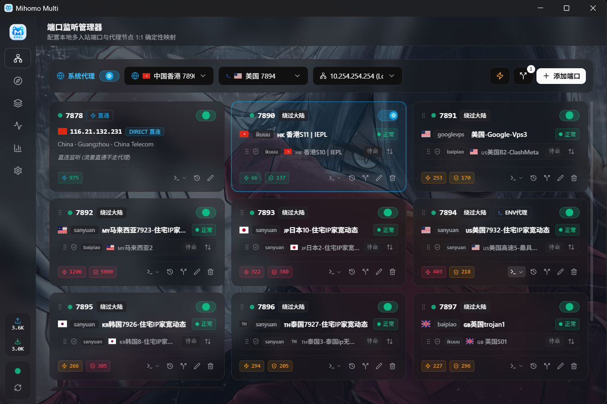
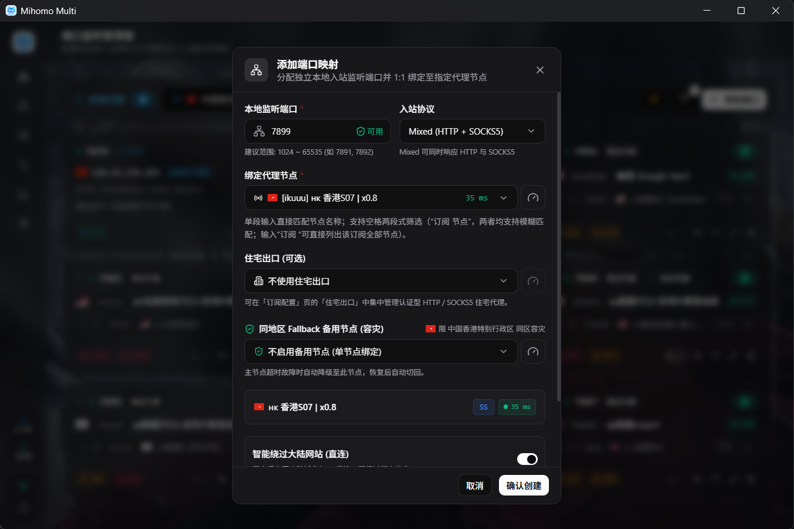
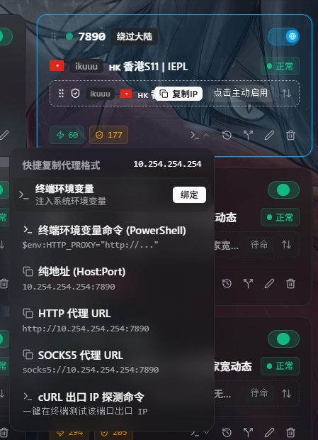
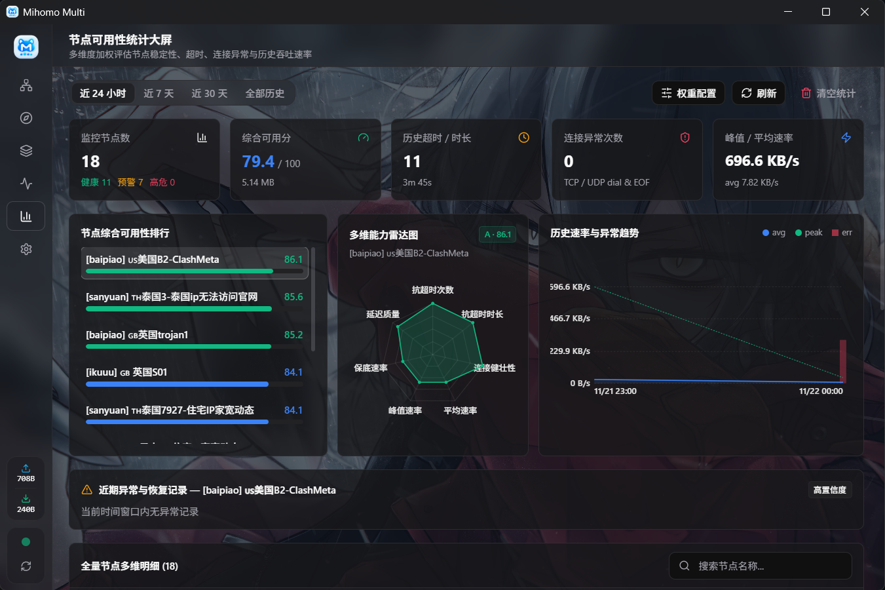
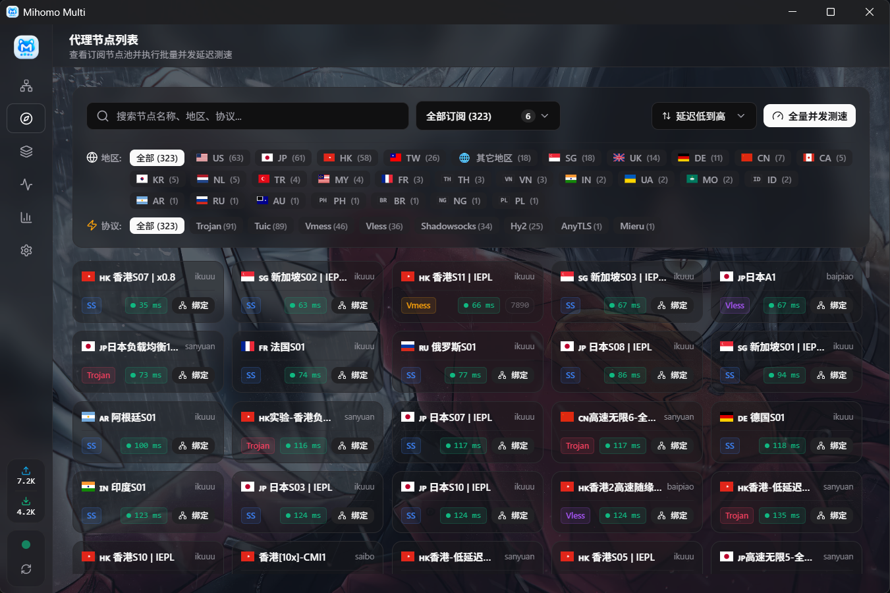
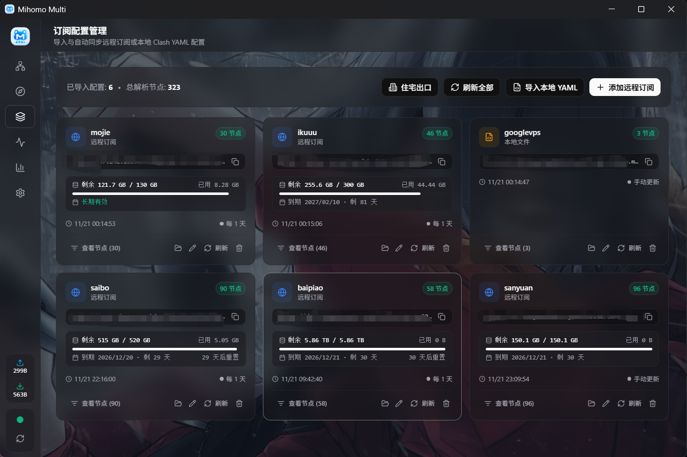
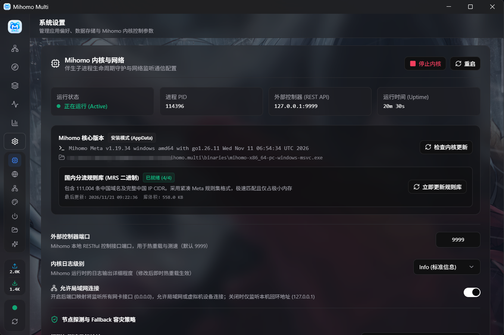

# Mihomo Multi (Clash Multi)

<p align="center">
  
</p>

<p align="center">
  <b>A Lightweight, Purpose-Built Multi-Port Proxy Client Powered by Mihomo (Clash.Meta) & Tauri v2</b>
  <br />
  <i>One Kernel, Unlimited Isolated Local Proxy Ports — Zero YAML Hassle, Zero IP Drift</i>
</p>

<p align="center">
  <b>English</b> | <a href="README.zh-CN.md">简体中文</a>
</p>

<p align="center">
  <a href="https://github.com/ygq-future/mihomo-multi/releases"></a>
  <a href="https://github.com/ygq-future/mihomo-multi/releases"></a>
  
  
  <a href="LICENSE"></a>
</p>

---

## 📖 Why Mihomo Multi?

General-purpose proxy clients (such as Clash Verge) are built around a **single global mixed port**. While you can technically piece together multi-port listeners by hand-crafting YAML `listeners`, override scripts, and complex rule sets, **it is tedious, error-prone, and lacks visual tooling for per-port operations**. Running multiple proxy clients side by side is even worse—bloated RAM usage, port collisions, and accidental IP cross-contamination.

**Mihomo Multi is designed from day one around `Local Inbound Port → 1:1 Deterministic Proxy Node Binding`**:
With a single managed Mihomo sidecar (~30 MB RAM), you can visually spin up and manage as many isolated local ports as you need (e.g., `7891 → 🇯🇵 Japan`, `7892 → 🇭🇰 Hong Kong`, `7893 → 🇺🇸 US Residential Chain`) with zero drift and millisecond hot-reloading.

| Comparison | General Clients (Manual YAML / Multi-Instance) | 🚀 Mihomo Multi |
| :--- | :--- | :--- |
| **Multi-Port Setup** | Hand-edit `listeners` / `IN-PORT` rules or override scripts | **Visual point-and-click creation with pre-bind port conflict detection** |
| **IP Isolation & Anti-Leak** | Rule routing can misclassify; chained residential proxies are hard to wire and may leak | **Strict 1:1 port binding + residential chain fail-closed (`REJECT`, never falls back to direct)** |
| **Per-Port Governance** | No same-region failover, per-port process tracking, or per-port site rules UI | **Same-region Fallback, per-port process history, and per-port site routing rules** |
| **Daily Workflow** | Editing configs or switching windows; manually formatting terminal env vars | **Drag-to-swap ports, 1-click primary/fallback swap, quick copy/env binding, multi-level tray** |
| **Node Quality Insights** | One-off ping tests miss intermittent timeouts and jitter | **7-dimensional weighted availability scoring + 30-day trend history for bound nodes** |
| **Reload & Footprint** | Multiple instances eat 500 MB–1 GB+ RAM; changes often drop connections | **Single ~30 MB kernel, millisecond REST API hot-reload without dropping active connections** |

---

## 📸 Screenshots

<p align="center">
  
  <br />
  <sub>Multi-Port Overview: live port status, latency, same-region failover, and one-click outbound takeover</sub>
</p>

<p align="center">
  
  <br />
  <sub>Add Port Mapping: live port availability check, inline latency test, residential exit chaining, and same-region fallback</sub>
</p>

<p align="center">
  
  <br />
  <sub>Quick Actions: one-click terminal env injection, HTTP/SOCKS5/PowerShell snippets, and cURL exit-IP probe</sub>
</p>

<p align="center">
  
  <br />
  <sub>Node Availability Analytics: 7-dimensional weighted scoring and 30-day trend charts focused on bound port nodes</sub>
</p>

<details>
<summary><b>Expand more screenshots (Node Pool, Subscriptions, Kernel Settings)</b></summary>
<br />

<p align="center">
  
  <br />
  <sub>Node Pool: 55+ country/region & protocol filters, concurrent latency testing, and one-click port binding</sub>
</p>

<p align="center">
  
  <br />
  <sub>Subscriptions: multi-subscription management with remaining traffic quota, expiry tracking, and residential exit manager</sub>
</p>

<p align="center">
  
  <br />
  <sub>Kernel & System Settings: managed sidecar status, automatic MRS rule updates, and LAN access toggle</sub>
</p>

</details>

---

## 💡 Use Cases

- 🌐 **Anti-Detect / Fingerprint Browsers**: Pair with AdsPower, Hubstudio, BitBrowser, etc., assigning each browser profile its own dedicated local port and isolated exit IP.
- 📱 **Cross-Border Multi-Account Operations**: Isolate TikTok, Facebook, X (Twitter), Amazon, or Shopee workspaces using clean `Subscription Relay → Authenticated Residential Proxy` chains.
- 🕷️ **Concurrent Scraping & Multi-Worker Pipelines**: Point each worker or crawler process to a separate local port for a deterministic, multi-IP local proxy pool.
- 💻 **Multi-Environment Dev & Terminal Isolation**: Inject or copy per-port proxy environment variables for different terminals and IDEs without toggling a global proxy, and verify exit IPs with one-click cURL commands.

---

## ✨ Purpose-Built Multi-Port Features & Practical Details

### 1. Effortless Visual Multi-Port Management
- **Unlimited Ports + Direct Reference**: Create any number of Mixed / HTTP / SOCKS5 listeners plus a fixed `DIRECT` reference port, with automatic pre-bind port conflict detection.
- **Drag-to-Swap Ports & 1-Click Primary/Fallback Swap**: Drag a listener card handle onto another card to atomically swap their listening ports, or swap primary and fallback nodes in one click/drag—applied via millisecond hot-reload **without dropping active connections**.
- **Inline Selector Speedtest & Region Quick-Search**: Type 2-letter region codes (`jp`, `hk`, `us`, `sg`, etc., across 55+ regions) inside node/port/residential selectors to filter instantly, and run single or batch latency tests right inside the dropdown.

### 2. Deterministic Anti-Leak: Same-Region Failover & Residential Proxy Chains
- **Same-Region Fallback**: Attach a fallback node from the same region to any port. If the primary node times out, traffic fails over smoothly and automatically switches back once recovered.
- **Residential Exit Chains (`Relay → Residential IP`)**: Manage authenticated HTTP/SOCKS5 residential proxies and chain `Local Port → Subscription Relay → Residential Exit → Target` with zero manual YAML.
  - **Fail-Closed IP Protection**: Chained ports bypass direct/split rules and fallbacks; if the relay or residential proxy is unavailable, traffic is strictly `REJECT`ed—never leaked to direct.
  - **Pre-Flight Connection Test**: Test any `Relay → Residential Exit` combination before creating a port using an isolated temporary Mihomo instance to verify end-to-end latency, final IPv4, and geolocation without touching live listeners.

### 3. Per-Port Governance: Process Tracking, Site Rules & Terminal Workflow
- **Per-Port Process History & Safe Deletion**: Tracks which local applications route through each port (app icon, executable path, hit count, and last active time) and warns you before deleting a port that is actively in use.
- **Per-Port Site Routing Rules**: Override specific domains on an individual port to route through a chosen node or direct (with built-in presets for AI, dev tools, streaming, and social platforms) without affecting other ports.
- **Quick Copy & Terminal Env Binding**: Copy `Host:Port`, HTTP/SOCKS5 URLs, PowerShell/CMD/Bash commands, or cURL exit-IP probes from any port card—or bind Windows user environment variables in one click.

### 4. Bound Node Availability Analytics (30-Day History)
- Focuses strictly on primary and fallback nodes bound to your listening ports with zero extra probe overhead (reusing kernel latency history, logs, and connection snapshots). Provides customizable **7-dimensional weighted availability scores** (timeout count/duration, connection errors, active avg/max/min speed, latency, and jitter) with 30-day visual trends.

### 5. Native Multi-Level System Tray Control
- Control everything without opening the main window: expand per-port submenus to toggle listeners, inspect primary/fallback latencies, probe and copy the active public exit IP, switch System Proxy / TUN target ports, or copy terminal proxy commands.

### 6. Complete Core Proxy Capabilities
- Also includes all standard essentials out of the box: multi-subscription & local YAML management (with traffic quota and expiry parsing), concurrent node speedtesting, 3-way outbound takeover (`Off / System Proxy / Managed Windows TUN` with automatic cleanup on exit to prevent broken internet), live connection monitor, Windows UWP loopback exemption, automatic MRS rule updates, English & Simplified Chinese UI with adaptive light/dark themes, and ~30 MB Tauri v2 footprint.

---

## 📥 Downloads

Grab the installer or portable package for your platform from [GitHub Releases](https://github.com/ygq-future/mihomo-multi/releases):

- **Windows (x64 / ARM64)**: `.exe` (NSIS installer), `.zip` (portable, extract and run), and `.msi` installer.
- **macOS (Apple Silicon / Intel / Universal)**: `.dmg` disk image.
- **Linux (x86_64)**: `.AppImage`, `.deb`, and `.tar.gz` portable archive.

> **🍏 macOS "App is damaged" or unverified developer notice?**  
> Run the following command in Terminal to clear the Gatekeeper quarantine attribute:  
> ```bash
> sudo xattr -rd com.apple.quarantine /Applications/Mihomo\ Multi.app
> ```

---

## 🛠️ Development

```bash
# 1. Clone and install dependencies
git clone https://github.com/ygq-future/mihomo-multi.git
cd mihomo-multi && pnpm install

# 2. Download the matching Mihomo sidecar binary for your platform
pnpm dev:sidecar

# 3. Start development mode
pnpm dev:tauri

# 4. Build production packages
pnpm build:tauri
```

---

## 🔍 Keywords

`clash multi` | `mihomo multi` | `clash multi port` | `multi-port proxy listener` | `anti-detect browser proxy` | `residential proxy chain` | `multi-ip proxy pool` | `adspower proxy` | `tauri proxy client`

---

## 📄 License

Licensed under the [MIT License](LICENSE).
