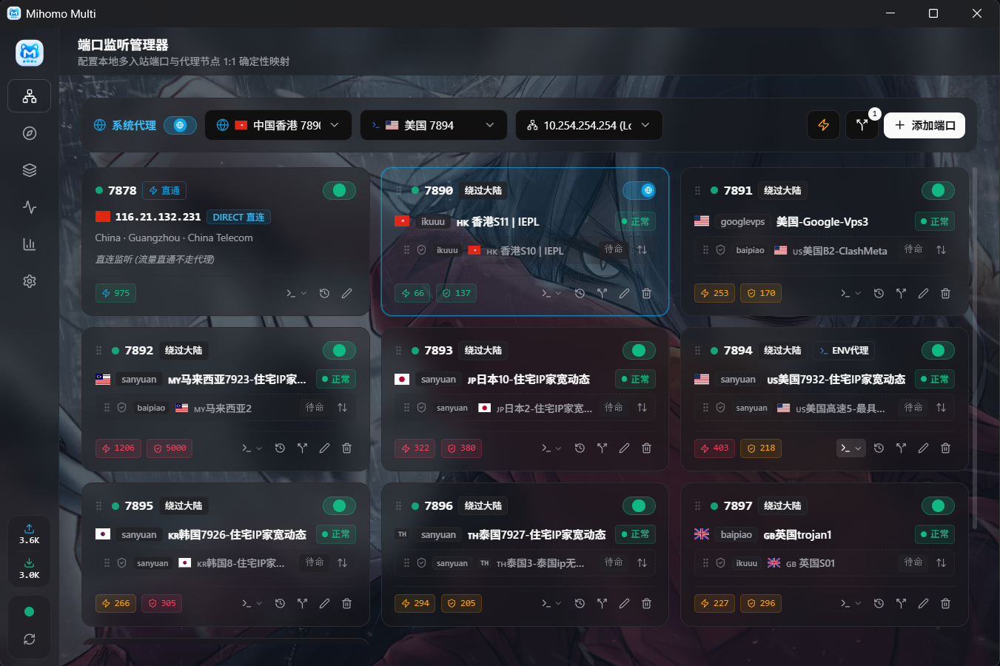
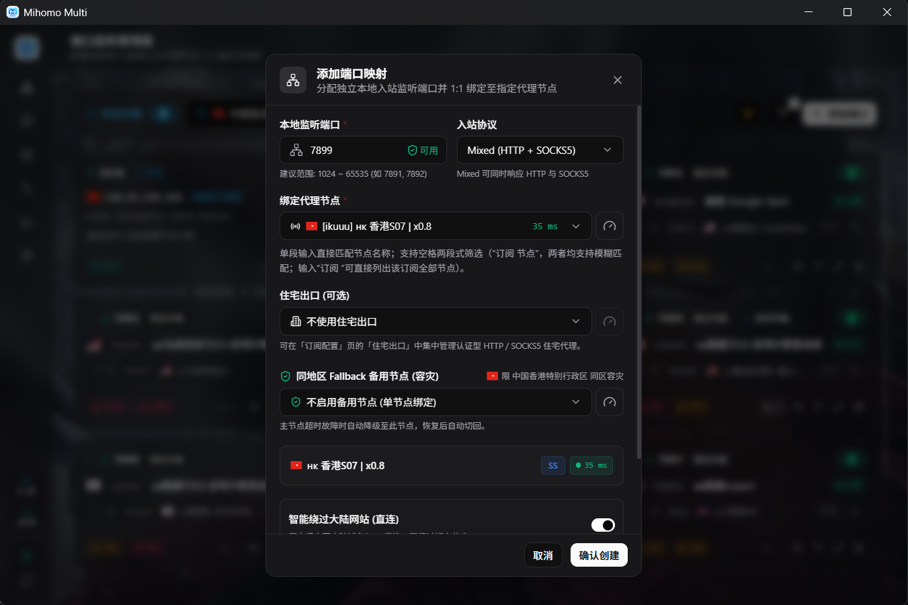
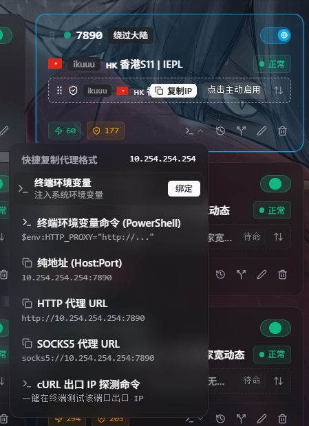
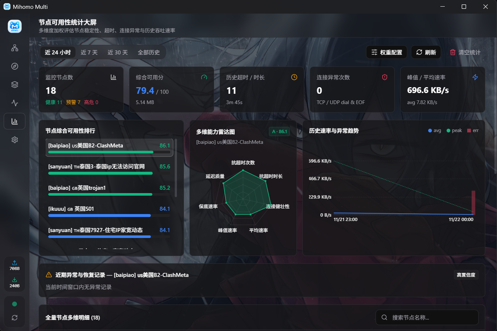
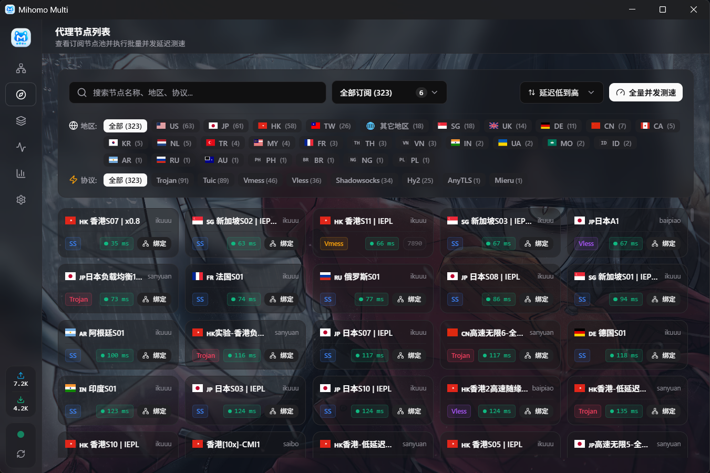
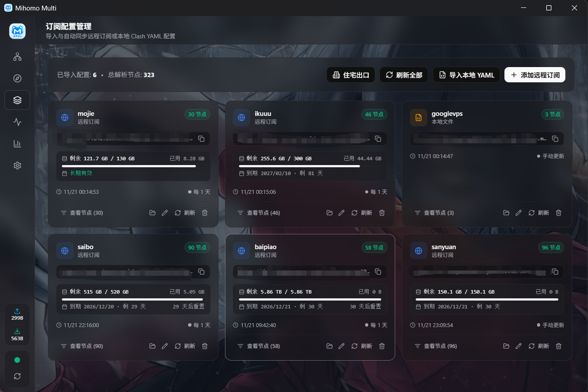
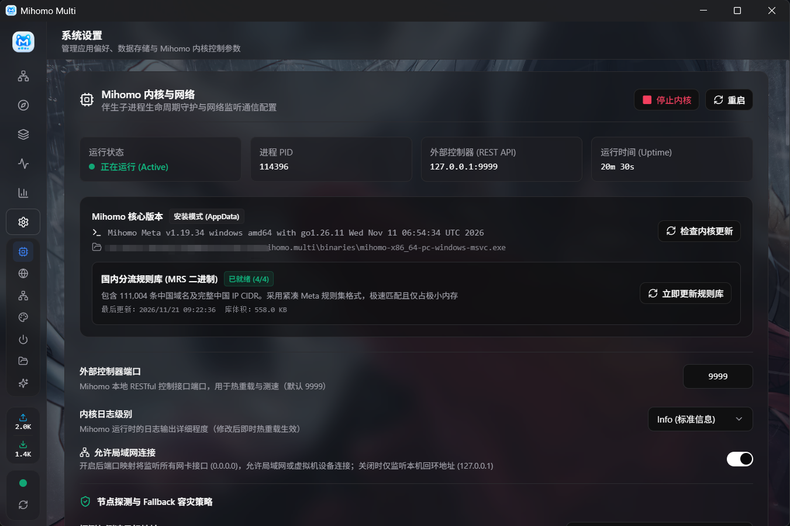

# Mihomo Multi (Clash Multi)

<p align="center">
  
</p>

<p align="center">
  <b>专为「多端口监听」与「代理多开」打磨的轻量级 Mihomo (Clash.Meta) 桌面客户端</b>
  <br />
  <i>A Lightweight, High-Performance Multi-Port Proxy Client Based on Mihomo (Clash.Meta) & Tauri v2</i>
</p>

<p align="center">
  <a href="README.md">English</a> | <b>简体中文</b>
</p>

<p align="center">
  <a href="https://github.com/ygq-future/mihomo-multi/releases"></a>
  <a href="https://github.com/ygq-future/mihomo-multi/releases"></a>
  
  
  <a href="LICENSE"></a>
</p>

---

## 📖 为什么是 Mihomo Multi？

传统代理客户端（如 Clash Verge 等）以**单一全局代理端口**为核心设计。虽然它们也能通过手写 YAML `listeners`、覆写脚本和复杂规则集拼凑出多端口监听，但**配置门槛高、维护极易出错，且缺乏针对多端口场景的可视化治理工具**；而同时多开多个客户端又会导致内存飙升、端口冲突与 IP 串线。

**Mihomo Multi 从第一天起就围绕「多端口监听 → 1:1 精确绑定指定节点」原生打造**：
只需一个常驻内存 ~30MB 的受控 Mihomo 内核，即可在图形界面中轻松管理任意数量的独立本地端口（如 `7891 → 🇯🇵 日本`、`7892 → 🇭🇰 香港`、`7893 → 🇺🇸 美国住宅链路`），实现真正确定、隔离、零漂移的“一个软件，多个代理端口”。

| 对比维度 | 通用客户端（手写 YAML / 多开软件） | 🚀 Mihomo Multi |
| :--- | :--- | :--- |
| **多端口配置成本** | 需手写 `listeners` / `IN-PORT` 规则或覆写脚本，改一次折腾半天 | **全可视化点选创建，内置端口冲突前置探测，开箱即用** |
| **IP 隔离与防串线** | 规则分流易误判，住宅链式代理配置繁琐，异常易回退直连漏 IP | **端口 1:1 确定性绑定 + 住宅链路防泄漏（异常直接 REJECT）** |
| **端口级容灾与治理** | 缺少同地区主备切换、端口级进程追踪与独立分流界面 | **同地区 Fallback 容灾、端口进程追踪、端口级特定网站分流** |
| **日常操作效率** | 切换端口/节点需改配置或切窗口，终端环境变量需手动拼接 | **拖拽换位、主备一键互换、快捷复制/注入终端、多级托盘直控** |
| **节点质量洞察** | 仅看单次测速延迟，难以发现偶发超时与丢包抖动 | **已绑定节点 7 维加权可用性分析 + 30 天持久化趋势** |
| **变更与资源占用** | 多开占用 500MB~1GB+，改配置常需重载断连 | **单内核 ~30MB 常驻，REST API 毫秒级热重载，长连接不断** |

---

## 📸 界面预览 (Screenshots)

<p align="center">
  
  <br />
  <sub>多端口监听总览：独立端口状态、实时延迟、同地区容灾与一键出站接管</sub>
</p>

<p align="center">
  
  <br />
  <sub>添加端口映射：端口可用性实时探测、节点快搜测速、住宅出口链式绑定与同地区 Fallback 容灾</sub>
</p>

<p align="center">
  
  <br />
  <sub>端口快捷联动：一键注入终端环境变量、复制 HTTP/SOCKS5/PowerShell 命令及 cURL 出口 IP 探测</sub>
</p>

<p align="center">
  
  <br />
  <sub>节点可用性分析：聚焦已绑定端口的节点，提供 7 维加权评分与 30 天历史趋势</sub>
</p>

<details>
<summary><b>点击展开更多界面截图（节点池、订阅管理、内核设置）</b></summary>
<br />

<p align="center">
  
  <br />
  <sub>节点池：支持 55+ 国家/地区与协议筛选、全量并发测速与一键绑定端口</sub>
</p>

<p align="center">
  
  <br />
  <sub>订阅管理：多订阅统一纳管，直观展示剩余流量、到期时间与住宅出口入口</sub>
</p>

<p align="center">
  
  <br />
  <sub>内核与系统设置：伴生内核状态监控、MRS 规则库自动更新与局域网监听开关</sub>
</p>

</details>

---

## 💡 典型应用场景 (Use Cases)

- 🌐 **指纹浏览器多开防关联**：配合 AdsPower、Hubstudio、BitBrowser、比特浏览器等，一机分配多个独立本地端口，各浏览器环境独享独立节点或住宅 IP，彻底杜绝串线。
- 📱 **海外多账号矩阵运营**：TikTok、Facebook、X (Twitter)、Amazon、Shopee 等跨国业务，通过「订阅中转 + 认证住宅代理」链路实现多账号、多地区纯净出口隔离。
- 🕷️ **并发爬虫与多 Worker 采集**：为不同采集进程或脚本分配不同本地监听端口，轻松构建稳定可控的本地多出口代理池。
- 💻 **多环境开发联调与终端隔离**：无需反复切换全局代理，直接为不同终端或 IDE 复制/注入指定端口的代理环境变量，并一键执行 cURL 验证出口 IP。

---

## ✨ 专为多端口打磨的核心能力与实用细节

### 1. 极速可视化多端口管理与零摩擦交互
- **任意端口 + 直连对照**：支持创建任意数量的 Mixed / HTTP / SOCKS5 监听端口及固定 `DIRECT` 直连对照端口，创建前自动检测本机端口占用。
- **卡片拖拽换位 & 主备一键互换**：直接拖动监听卡片手柄即可与另一张卡片原子交换监听端口；也可一键或拖拽将备用节点切换为主节点，变更通过热重载毫秒级生效，**已有长连接不断**。
- **选择器内即时测速与地区快搜**：节点、关联端口与住宅出口下拉框支持直接输入 `jp`、`hk`、`us`、`sg` 等 55+ 地区缩写快速筛选，并可在下拉列表内直接单点或批量测速，选完即用。

### 2. 确定性防串线：同地区容灾 & 住宅出口链式代理
- **同地区 Fallback 备用节点**：为端口绑定同地区备用节点，主节点超时自动降级，恢复后自动切回，兼顾高可用与出口地区一致性。
- **住宅出口链式代理（中转 → 住宅 IP）**：内置带账密认证的 HTTP/SOCKS5 住宅代理管理，一键串联 `本地端口 → 订阅中转节点 → 住宅出口 → 目标网站`。
  - **严格防漏 IP**：链路端口不应用国内直连、分流规则或备用节点，中转或住宅代理异常时直接拒绝连接（`REJECT`），绝不回退直连。
  - **免建端口预检**：在住宅出口管理中可直接选择中转节点「测试连接」，通过独立临时内核验证完整链路延迟、最终出口 IPv4 与归属地，不影响当前运行中的任何端口。

### 3. 端口级精细治理：进程追踪、专属分流与终端联动
- **端口进程记录与防误删保护**：按端口自动归集经过的本机应用进程（展示应用图标、路径、命中次数与活跃时间）；删除端口前自动预警正在使用该端口的程序，避免误删导致业务断网。
- **端口级特定网站分流**：可为单个端口单独配置指定域名走特定节点或直连（内置 AI 大模型、开发工具、流媒体、社交通讯等常用预设），各端口规则完全独立。
- **快捷复制与终端环境变量绑定**：每张端口卡片支持一键复制 `Host:Port`、HTTP/SOCKS5 URL、PowerShell/CMD/Bash 命令及 cURL 出口 IP 探测命令，Windows 下可直接一键绑定系统用户环境变量。

### 4. 已绑定节点可用性分析（30 天持久化洞察）
- 聚焦真正挂载在监听端口上的主备节点，零额外探测开销（复用内核延迟历史、日志与连接快照），提供可自定义权重的 **7 维加权可用性评分**（超时次数、超时总时长、连接错误、活跃平均/最大/最小速率、延迟与抖动）与 30 天趋势图，直观排查隐性不稳节点。

### 5. 原生多级托盘直控
- 无需打开主窗口，直接在系统托盘按端口展开二级菜单：查看主备节点实时延迟、启停端口、一键探测并复制当前活动节点的公网出口 IP、切换系统代理/TUN 出口，或快速复制终端代理命令。

### 6. 完备的基础代理能力
- 同样内置完善的通用能力：多远程订阅与本地 YAML 管理（自动解析剩余流量与到期时间）、高并发节点测速、首页三段式出站接管（关闭 / 系统代理 / Windows 受控 TUN 虚拟网卡，退出自动清理防断网）、实时连接监控、Windows UWP 回环豁免、MRS 规则库自动更新、中英双语与自适应明暗主题，以及基于 Tauri v2 的极低资源占用与多级代理加速更新。

---

## 📥 下载与安装 (Downloads)

前往 [GitHub Releases](https://github.com/ygq-future/mihomo-multi/releases) 下载适合您操作系统的安装包：

- **Windows (x64 / ARM64)**: 提供 `.exe` (NSIS 安装包)、`.zip` (免安装便携版，解压即用) 与 `.msi` 安装程序。
- **macOS (Apple Silicon / Intel / Universal)**: 下载对应架构的 `.dmg` 镜像并拖入 Applications 目录。
- **Linux (x86_64)**: 提供 `.AppImage`、`.deb` 安装包与 `.tar.gz` 便携归档包。

> **🍏 macOS 首次打开提示“已损坏”或“无法验证开发者”？**  
> 打开终端执行以下命令解除系统的 Gatekeeper 隔离标记即可：  
> ```bash
> sudo xattr -rd com.apple.quarantine /Applications/Mihomo\ Multi.app
> ```

---

## 🛠️ 开发者快速上手 (Development)

```bash
# 1. 克隆代码仓库并安装依赖
git clone https://github.com/ygq-future/mihomo-multi.git
cd mihomo-multi && pnpm install

# 2. 自动拉取适配当前平台的 Mihomo Sidecar 内核
pnpm dev:sidecar

# 3. 启动开发模式
pnpm dev:tauri

# 4. 构建生产分发安装包
pnpm build:tauri
```

---

## 🔍 核心关键词 (Keywords)

`clash multi` | `mihomo multi` | `clash多端口监听` | `代理多开` | `多端口代理` | `mihomo多端口` | `指纹浏览器代理` | `住宅代理链式转发` | `多出口IP代理` | `clash multi port` | `multi-port proxy listener` | `anti-detect browser proxy` | `tauri proxy client`

---

## 📄 开源协议 (License)

本项目遵循 [MIT License](LICENSE) 开源协议。
